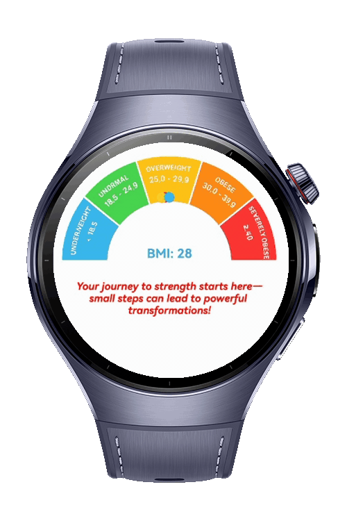

> **Note:** To access all shared projects, get information about environment setup, and view other guides, please visit [Explore-In-HMOS-Wearable Index](https://github.com/Explore-In-HMOS-Wearable/hmos-index).

# How To Use Stack

Stack Usage App allows users to quickly calculate their Body Mass Index by entering height and weight. With clear results based on standard BMI categories, it helps users understand and monitor their health status easily.

# Preview

<div>

</div>

# Use Cases

1. Health Awareness: Helps users understand if they are underweight, normal, overweight, or obese according to standard BMI categories.

2. Fitness Tracking: Users can regularly calculate BMI to monitor changes over time as part of their fitness journey.

3. Health Monitoring: Supports individuals in keeping track of their weight-related health risks.

4. User-Friendly Experience: Provides clear results in a minimal interface, making it accessible for all age groups.

# Tech Stack

- **Languages**: ArkTS
- **Frameworks**: HarmonyOS SDK 5.0.0(12)
- **Tools**: DevEco Studio Vers 5.1.0.842
- **Libraries**: @kit.ArkUI

# Directory Structure
   ```
   entry/src/main/ets/
   |---pages
   |   |---Index.ets             //Home Page
   ```
# Constraints and Restrictions
## Suported Devices
- Huawei Watch 5

# License
**StackUsageApp** is distributed under the terms of the MIT License
See the [LICENSE](./LICENSE) for more information.